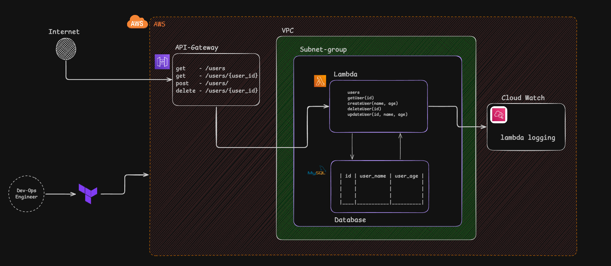

# AWS User Management API using Terraform

This is a hands-on project I built to learn how to provision AWS infrastructure using **Terraform (Infrastructure as Code)** instead of creating resources manually through the AWS Console.

The goal was to understand how different AWS services work together to build a simple user management REST API.

## Architecture



## AWS Services Used

- **Amazon API Gateway (REST API):** Exposes API endpoints for user operations.
- **AWS Lambda:** Handles API requests and application logic.
- **Amazon RDS (MySQL):** Stores user information.
- **Amazon VPC:** Provides network isolation for Lambda and the database.
- **Amazon CloudWatch:** Stores Lambda execution logs.
- **Terraform:** Provisions and manages the AWS infrastructure as code.

## API Endpoints

| Method | Endpoint | Description |
|---|---|---|
| GET | `/users` | Retrieve users |
| POST | `/users` | Create a user |
| GET | `/users/{user_id}` | Retrieve a user by ID |
| PUT | `/users/{user_id}` | Update a user |
| DELETE | `/users/{user_id}` | Delete a user |
| POST | `/query` | Execute custom SQL for learning purposes |

**Note:** The `/query` endpoint is intended only for experimentation. Do not expose an arbitrary SQL execution endpoint publicly in a production environment.

## Project Structure

```text
.
├── main.tf
├── variables.tf
├── terraform.tfvars
├── app/
│   ├── main.py
│   ├── database.py
│   └── requirements.txt
└── README.md
```

- `main.tf` — AWS resource definitions.
- `variables.tf` — Terraform input variables.
- `terraform.tfvars` — Values for Terraform variables.
- `app/main.py` — Lambda handler and API routing.
- `app/database.py` — MySQL connection and database operations.
- `app/requirements.txt` — Python dependencies.

## What I Learned

- Provisioning AWS infrastructure using Terraform.
- Integrating API Gateway with Lambda.
- Connecting Lambda to a private RDS MySQL database.
- Configuring VPC networking and security groups.
- Managing database connection settings through Lambda environment variables.
- Using CloudWatch to troubleshoot Lambda execution.
- Understanding the benefits of Infrastructure as Code.

## Setup and Deployment

**Prerequisites**

- An AWS account and configured AWS CLI.
- Terraform installed.
- Python installed.
- Appropriate AWS IAM permissions.

**Deploy the infrastructure**

```bash
terraform init
terraform fmt
terraform validate
terraform plan
terraform apply
```

Review the Terraform plan before applying it.

After deployment, retrieve the API URL using the Terraform output configured in the project:

```bash
terraform output -raw api_invoke_url
```

Use the returned URL to test the endpoints with a tool such as Thunder Client.

## Cleanup

To remove the resources created by Terraform:

```bash
terraform destroy
```

Review the destruction plan before confirming. Make sure the Terraform state is protected because it can contain sensitive infrastructure values.

## Security Notes

- Keep the RDS database private.
- Restrict database access using security groups.
- Never commit real credentials, passwords, or sensitive Terraform state to GitHub.
- Avoid exposing the custom SQL endpoint without appropriate access controls.

## Why I Built This

I believe hands-on practice is one of the best ways to learn cloud infrastructure. This project helped me move beyond studying AWS concepts and start understanding how the services fit together in a working application.

I'm continuing to learn and improve this project as I explore more AWS and DevOps concepts.
